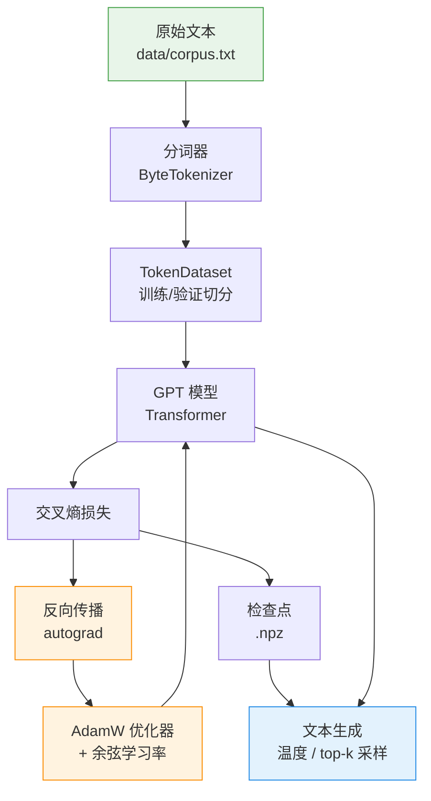
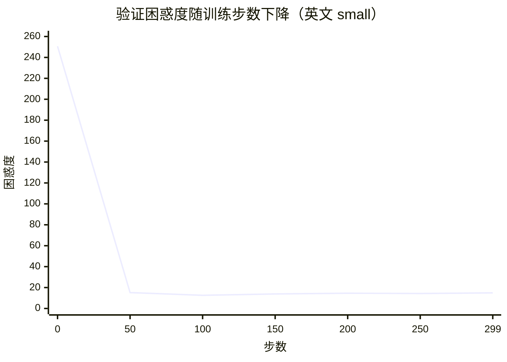

# NeuroLM

**一个用纯 NumPy 从零实现的语言模型训练系统。**

NeuroLM 完整地训练一个小型 decoder-only Transformer：从分词、数据集构建、
自动求导、优化器、训练循环，到评估与文本生成。它不依赖任何深度学习框架 ——
只需要 NumPy 和 PyYAML —— 因此整条技术栈都清晰可读、随时可以动手改造。

> 本项目正在持续开发中。下一步计划见 [`docs/ROADMAP.md`](docs/ROADMAP.md)，
> 变更历史见 [`DEVELOPMENT_LOG.md`](DEVELOPMENT_LOG.md)（开发日志）。

---

## 全景图

下图展示了从原始文本到生成结果的完整数据流，以及各模块之间的依赖关系。



## 为什么"从零实现"？

大多数教程把最有趣的部分藏在了框架后面。NeuroLM 把它们全都摊开给你看：

- **真正的自动求导引擎。** [`src/neurolm/autograd.py`](src/neurolm/autograd.py)
  在一个小型张量库上实现了反向模式自动微分。梯度正确性由测试套件中的
  数值微分校验保证。
- **真正的 Transformer。** 多头因果注意力、pre-norm 残差块、前馈网络，
  全部用自动求导原语表达。
- **真正的训练循环。** AdamW（解耦权重衰减）、带预热的余弦学习率调度、
  全局梯度裁剪、周期性验证与检查点保存。

## 功能特性

| 模块 | 提供的能力 |
|------|-----------|
| 分词 | 字节级分词器：无需训练词表、不存在未登录词、UTF-8 精确往返 |
| 模型 | Decoder-only Transformer，层数/宽度/头数均可配置 |
| 自动求导 | 反向模式引擎，支持广播、矩阵乘、层归一化、GELU、softmax、交叉熵 |
| 优化 | AdamW、余弦学习率调度、梯度裁剪 |
| 训练 | 批量采样、训练/验证切分、评估、检查点、JSON 历史记录 |
| 推理 | 从任意检查点进行温度采样与 top-k 采样 |
| 工程 | 命令行工具、YAML 配置、Makefile、pytest 测试、GitHub Actions CI |

## 快速开始

```bash
# 1. 安装（仅需 NumPy + PyYAML）
pip install -e ".[dev]"

# 2. 训练 tiny 配置 —— 在 CPU 上几秒钟完成
make train-tiny

# 3. 训练 small 配置 —— 在笔记本 CPU 上约 90 秒
make train-small

# 4. 训练中文配置（使用 data/corpus_zh.txt）
python -m neurolm train --config configs/zh.yaml

# 5. 从训练好的模型采样
make generate PROMPT="The transformer "
```

或者直接使用命令行：

```bash
export PYTHONPATH=src
python -m neurolm train     --config configs/small.yaml
python -m neurolm evaluate  --config configs/small.yaml --checkpoint runs/small/final.npz
python -m neurolm generate  --config configs/small.yaml --checkpoint runs/small/final.npz \
                            --prompt "The model " --max-new-tokens 200 --temperature 0.8
```

## 训练结果

### 英文（`small` 配置）

在自带语料库（`data/corpus.txt`）上训练 `small` 配置：

| 步数 | 训练损失 | 验证损失 | 验证困惑度 |
|-----:|---------:|---------:|-----------:|
| 0    | 5.557    | 5.524    | 250.7      |
| 50   | 2.704    | 2.722    | 15.2       |
| 100  | 2.449    | 2.532    | 12.6       |
| 299  | 1.970    | 2.699    | 14.9       |

困惑度从约 250（随机水平）降到约 13，采样出的文本开始呈现英文结构。
用 `make train-small` 可复现。

### 中文（`zh` 配置）

在中文语料（`data/corpus_zh.txt`）上训练 `zh` 配置：

| 步数 | 训练损失 | 验证损失 | 验证困惑度 |
|-----:|---------:|---------:|-----------:|
| 0    | 5.551    | 5.518    | 249.2      |
| 50   | 2.880    | 2.983    | 19.7       |
| 100  | 2.548    | 2.773    | 16.0       |
| 199  | 2.153    | 2.571    | 13.1       |

```bash
python -m neurolm train --config configs/zh.yaml
```

> **关于中文生成的说明：** 字节级分词下每个汉字约占 3 个 token，因此模型需要
> 处理更长的序列。当前小模型 + 小语料的组合下，中文困惑度能稳定下降，但采样出的
> 文本仍以"字"为单位、连贯性有限。要获得流畅的中文生成，需要更大的模型、更多
> 语料，以及[路线图](docs/ROADMAP.md)中的子词分词器。



## 项目结构

```
.
├── configs/              # YAML 运行配置（tiny、small、zh）
├── data/                 # 训练语料（英文 corpus.txt、中文 corpus_zh.txt）
├── docs/                 # 架构、上手指南、路线图
├── scripts/              # 辅助脚本（绘图、训练并采样）
├── src/neurolm/
│   ├── autograd.py       # 反向模式自动求导引擎
│   ├── config.py         # 带类型校验的配置
│   ├── tokenizer.py      # 字节级分词器
│   ├── cli.py            # 命令行接口
│   ├── data/             # 数据集与批处理
│   ├── models/           # Transformer（GPT）、参数
│   └── training/         # 优化器、训练器、检查点、评估
└── tests/                # pytest 测试套件（36 个测试）
```

## 文档

- [上手指南](docs/GETTING_STARTED.md) —— 安装、训练、采样、调参。
- [架构说明](docs/ARCHITECTURE.md) —— 各模块如何协作。
- [路线图](docs/ROADMAP.md) —— 后续计划与扩展方式。
- [开发日志](DEVELOPMENT_LOG.md) —— 按时间记录的变更。
- [变更记录](CHANGELOG.md) —— 面向版本的汇总。

## 环境要求

- Python 3.10+
- NumPy ≥ 1.24、PyYAML ≥ 6.0
- 无需 GPU（纯 CPU 可运行）

## 许可证

MIT —— 见 [LICENSE](LICENSE)。
