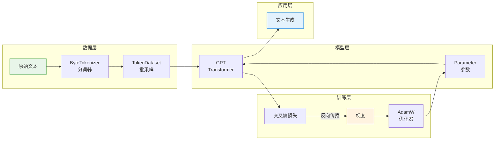
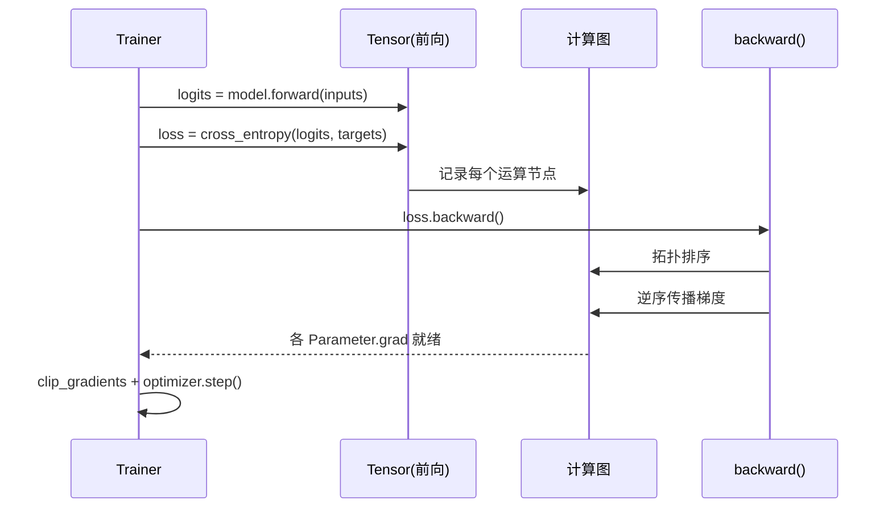
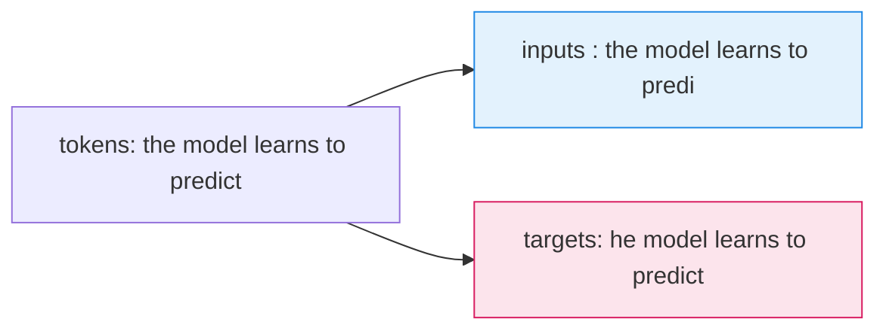
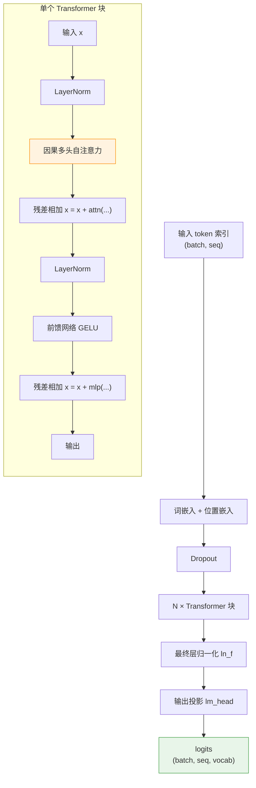
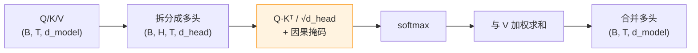
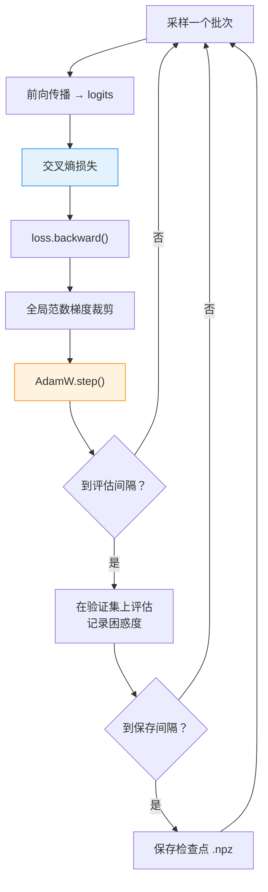
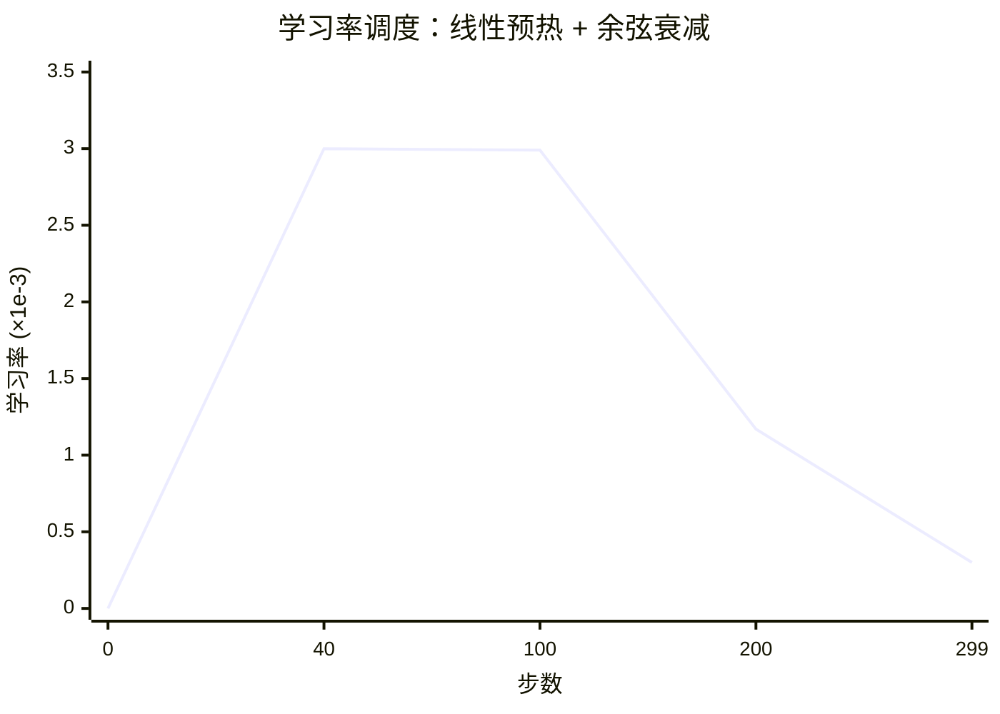
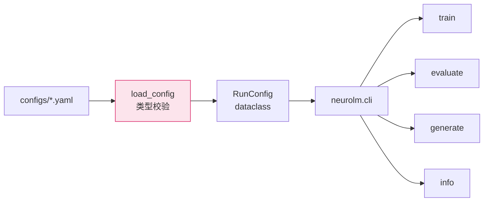

# 架构说明

本文解释 NeuroLM 是如何组织的，以及每一部分为何这样设计。建议对照源码阅读，
每一节都会指出相关文件。

## 总览

NeuroLM 是一个分层清晰的小型系统。数据单向流动，每一层只负责一件事：

## 第 1 层 —— 自动求导（`src/neurolm/autograd.py`）

整个系统的基础是一个反向模式自动微分引擎。一个
[`Tensor`](../src/neurolm/autograd.py) 封装了 NumPy 数组，并记录了产生它的运算。
对一个标量节点调用 `backward()` 时会：

1. 构建计算图中所有张量的拓扑序；
2. 用全 1 初始化输出梯度；
3. 逆序遍历图，依次调用每个节点的局部 `_backward`。

每个运算（加、乘、矩阵乘、reshape、求和……）都定义了自己的向量-雅可比乘积。
广播通过 `_unbroadcast` 处理，它会把梯度沿被广播的维度求和还原到原始形状。
复合运算（`softmax`、`log_softmax`、`layer_norm`、`gelu`、`cross_entropy`、
`embedding`）被写成专门的节点，配有解析推导的反向传播，以保证数值稳定性。

下面的时序图展示一次前向 + 反向的完整过程：

**正确性保证。** `tests/test_autograd.py` 用有限差分对照一个复合函数
（层归一化 → GELU → 矩阵乘 → softmax）的梯度进行校验。

## 第 2 层 —— 分词（`src/neurolm/tokenizer.py`）

`ByteTokenizer` 把文本映射到整数 `0..255`，并保留 `256`/`257` 作为序列的
开始/结束标记。字节级词表的好处是：

- 无需在语料上做词表训练；
- 永远不会产生未登录词；
- 任意 UTF-8 字符串都能精确往返。

代价是序列长度：字节比子词更"碎"，同样文本的序列更长。对于一个小而可读的
系统，这是合适的默认选择；子词分词器已列入[路线图](ROADMAP.md)。

## 第 3 层 —— 数据（`src/neurolm/data/dataset.py`）

语料库一次性分词为一个 `int64` 数组。`TokenDataset` 把它切分为训练/验证两部分，
并随机采样连续的块：

- **输入（inputs）** 是 `tokens[i : i+block]`；
- **目标（targets）** 是 `tokens[i+1 : i+block+1]`。

错位一格正是"预测下一个 token"任务的来源：

采样纯粹是整数索引，因此训练循环从不会因 I/O 而阻塞。

## 第 4 层 —— 模型（`src/neurolm/models/`）

`GPT` 是一个 decoder-only Transformer。对于形状为 `(batch, seq)` 的输入：

关键设计选择：

- **Pre-norm（前置归一化）。** 层归一化施加在每个子层*之前*。这能让深层堆叠中
  的梯度保持良好尺度，是现代标准做法。
- **因果掩码。** 一个固定的上三角 `-1e9` 掩码会加到注意力分数上，使位置 *t*
  只能关注位置 `≤ t`。掩码按序列长度缓存复用。
- **权重共享。** 输出投影可以与词嵌入矩阵共享权重，从而减少参数，通常还能
  改善小模型的表现。

注意力内部的张量形状变化：

`Parameter` 是 `Tensor` 的子类，始终需要梯度，并带有稳定的名字，这样优化器和
检查点就能按名字引用权重。

## 第 5 层 —— 训练（`src/neurolm/training/`）

`Trainer` 掌管模型、优化器和数据集，每一步：

**AdamW** 使用解耦权重衰减，使正则化不会干扰自适应学习率。学习率遵循
**线性预热 + 余弦衰减**（`cosine_lr`）。验证损失在多个批次上测量，并以困惑度
（`exp(loss)`）形式报告。

## 第 6 层 —— 接口（`src/neurolm/cli.py`）

命令行暴露四个子命令 —— `train`、`evaluate`、`generate`、`info` —— 并读取经过
校验的 YAML 配置（`src/neurolm/config.py`）。配置在加载时就被解析成带类型的
dataclass，因此配置文件里的拼写错误会立刻给出清晰报错，而不是在训练深处才浮现。

## 扩展点

| 想要修改…… | 编辑位置 |
|------------|---------|
| 模型规模/形状 | `configs/*.yaml`、`ModelConfig` |
| 架构（新增层类型） | `src/neurolm/models/gpt.py` |
| 优化器或调度 | `src/neurolm/training/optimizer.py` |
| 分词方案 | `src/neurolm/tokenizer.py` |
| 新增自动求导算子 | `src/neurolm/autograd.py` + 一个梯度校验测试 |
