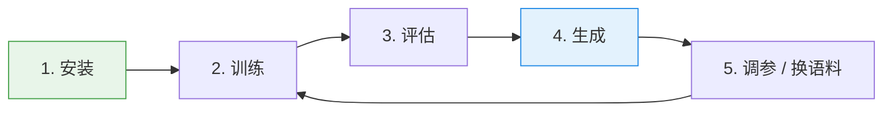
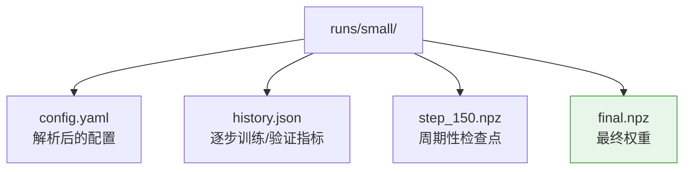
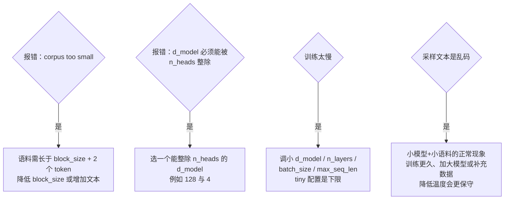

# 上手指南

本指南带你从零开始，一路走到训练好模型并生成文本。

## 整体流程



## 1. 安装

NeuroLM 需要 Python 3.10+ 和两个运行时依赖（NumPy、PyYAML）。

```bash
git clone https://github.com/chebanqlizhong/neurolm.git neurolm
cd neurolm
pip install -e ".[dev]"     # "dev" 会额外安装 pytest 和 ruff
```

如果你不想安装这个包，也可以直接源码运行，把 `src/` 加入路径即可：

```bash
export PYTHONPATH=src
```

## 2. 训练

最快确认一切正常的方式是 `tiny` 配置，几秒即可完成：

```bash
make train-tiny
```

想要一个真正学到东西的模型，请使用 `small`（笔记本 CPU 上约 90 秒）：

```bash
make train-small
```

如果想训练中文模型，使用 `zh` 配置（在 `data/corpus_zh.txt` 上训练）：

```bash
make train-zh
# 等价于：python -m neurolm train --config configs/zh.yaml
```

每次验证时你会看到一行日志：

```
步数     0 | 训练 5.5573 | 验证 5.5244 | 困惑度 250.73 | 学习率 7.50e-05 | |梯度| 1.77
步数    50 | 训练 2.7045 | 验证 2.7219 | 困惑度 15.21  | 学习率 2.99e-03 | |梯度| 0.58
步数   299 | 训练 1.9704 | 验证 2.6986 | 困惑度 14.86  | 学习率 3.00e-04 | |梯度| 0.99
```

产物位于 `runs/<run_name>/`：



## 3. 评估

测量检查点的损失与困惑度：

```bash
python -m neurolm evaluate \
  --config configs/small.yaml \
  --checkpoint runs/small/final.npz \
  --batches 20
```

## 4. 生成

从检查点采样文本：

```bash
python -m neurolm generate \
  --config configs/small.yaml \
  --checkpoint runs/small/final.npz \
  --prompt "The transformer " \
  --max-new-tokens 200 \
  --temperature 0.8 \
  --top-k 40
```

采样参数说明：

| 参数 | 作用 |
|------|------|
| `--temperature` | 越低（< 1）越保守，越高（> 1）越随机 |
| `--top-k` | 只在概率最高的 `k` 个 token 中采样（0 = 关闭） |
| `--seed` | 让采样结果可复现 |

## 5. 绘制损失曲线

```bash
python scripts/plot_history.py runs/small/history.json --out runs/small/loss.png
```

`matplotlib` 是可选依赖；未安装时脚本会打印 ASCII 曲线。

## 6. 配置你自己的训练

复制一个配置并修改：

```bash
cp configs/small.yaml configs/my_run.yaml
```

关键参数：

```yaml
run_name: my_run        # 决定输出目录名
model:
  d_model: 128          # 嵌入宽度（必须能被 n_heads 整除）
  n_heads: 4            # 注意力头数
  n_layers: 6           # Transformer 块数
  max_seq_len: 128      # 最大上下文长度
data:
  corpus_path: data/corpus.txt
  block_size: 128       # 每个训练样本的 token 数（<= max_seq_len）
  batch_size: 16
train:
  max_steps: 1000
  learning_rate: 3.0e-3
```

然后：

```bash
python -m neurolm train --config configs/my_run.yaml
```

## 7. 使用你自己的语料

把 `data.corpus_path` 指向任意 UTF-8 文本文件即可。越大、越多样越好。一个粗略的
经验值：至少需要几十万字符，模型才能学到拼写之外的东西。

## 8. 运行测试

```bash
make test      # pytest
make lint      # ruff
```

## 常见问题排查



**"corpus too small"** —— 语料必须长于 `block_size + 2` 个 token。降低
`block_size` 或增加文本。

**"d_model must be divisible by n_heads"** —— 选一个能被 `n_heads` 整除的
`d_model`（例如 128 与 4）。

**训练太慢** —— 调小 `d_model`、`n_layers`、`batch_size` 和 `max_seq_len`。
`tiny` 配置就是下限。

**采样文本是乱码** —— 小模型在少量语料上的正常现象。训练更久、用更大的模型，
或补充更多数据。降低温度会让输出更保守。
