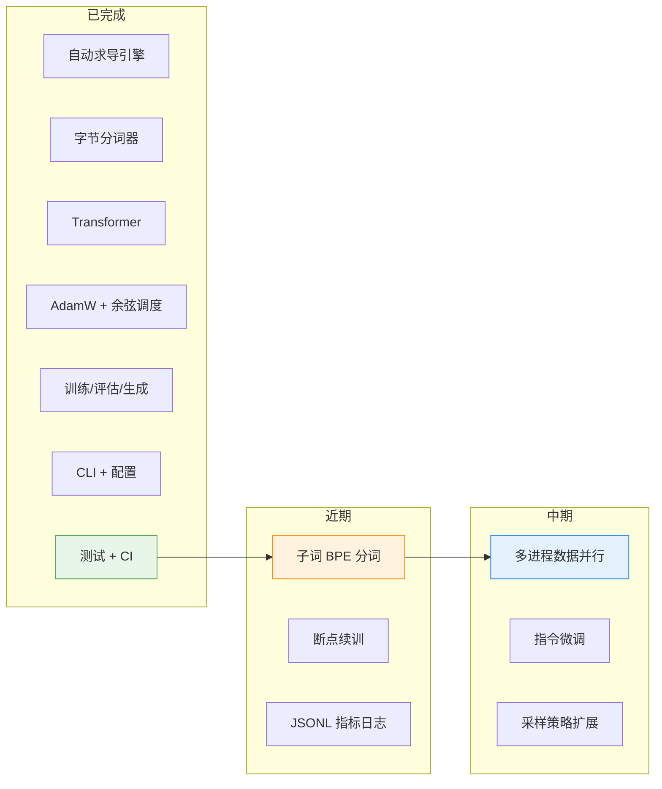

# 路线图

NeuroLM 是一个持续开发的项目。本文记录它当前在哪里、要往哪里去，以及你可以
如何扩展它。它会随进展更新；按时间记录的变更见
[`DEVELOPMENT_LOG.md`](../DEVELOPMENT_LOG.md)（开发日志）。

## 指导原则

1. **可读优先于炫技。** 每个组件都应能在一顿饭的时间里读懂。
2. **依赖极简。** 只需要 NumPy 和 PyYAML。
3. **经过验证。** 新行为都带测试；数值结论都会被校验。
4. **可复现。** 固定随机种子、记录解析后的配置与每次运行的指标。

## 进度概览

图例：✅ 已完成 · 🚧 进行中 · ⬜ 计划中

### 核心（已完成）

- ✅ 反向模式自动求导引擎，含梯度校验
- ✅ 字节级分词器，UTF-8 精确往返
- ✅ Decoder-only Transformer（pre-norm、因果注意力、权重共享）
- ✅ AdamW，解耦权重衰减
- ✅ 带预热的余弦学习率调度
- ✅ 全局范数梯度裁剪
- ✅ 训练循环：验证、检查点、JSON 历史
- ✅ 温度 / top-k 采样
- ✅ 命令行（`train`、`evaluate`、`generate`、`info`）
- ✅ 带类型校验的 YAML 配置
- ✅ pytest 测试套件 + GitHub Actions CI

### 近期

- ⬜ **子词分词器。** 训练一个 BPE 词表以缩短序列。
- ⬜ **指标日志。** 逐步输出机器可读的指标（CSV/JSONL）。
- ⬜ **断点续训。** 从检查点恢复优化器状态（Adam 动量），而不只是权重。
- ⬜ **混合精度。** 主权重保持 float32，在合适处用 bfloat16 风格的降精度做矩阵乘。
- ⬜ **注意力改进。** 分组查询注意力（GQA）与旋转位置编码（RoPE）。

### 中期

- ⬜ **多设备训练。** 跨进程的数据并行梯度平均。
- ⬜ **指令微调。** 在"提示/回答"数据对上做监督微调。
- ⬜ **评估工具集。** 超越验证困惑度的留出集基准。
- ⬜ **采样策略。** 核采样（top-p）、重复惩罚、束搜索。
- ⬜ **量化。** 仅权重的 int8 推理。

### 更远期

- ⬜ **检索增强生成（RAG）** 接口。
- ⬜ **偏好优化**（DPO 风格），建立在微调模型之上。
- ⬜ **模型卡**：根据每次运行的配置与指标自动生成。

## 如何贡献

1. 从上面挑一项（或提出新的一项）。
2. 在 `configs/` 下新增或扩展配置。
3. 尽量先写测试 —— 尤其是新的自动求导算子，有限差分校验是硬性标准。
4. 更新 [`DEVELOPMENT_LOG.md`](../DEVELOPMENT_LOG.md)，如果是用户可见的行为，
   还要更新本路线图和[变更记录](../CHANGELOG.md)。
5. 保持改动聚焦。小而可审的改动合并得更快。

## 非目标

- 在生产框架的速度或规模上竞争。
- 支持所有架构。NeuroLM 面向的是能在单张 CPU 或 GPU 上训练的小型
  decoder-only 语言模型。
